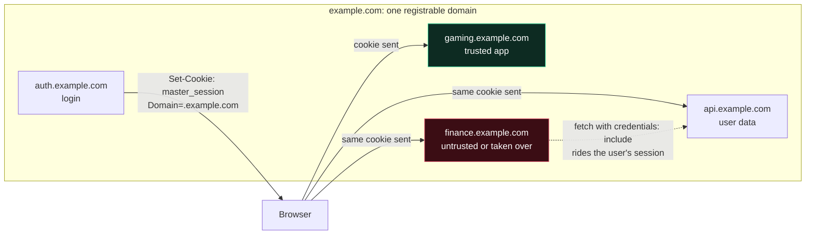
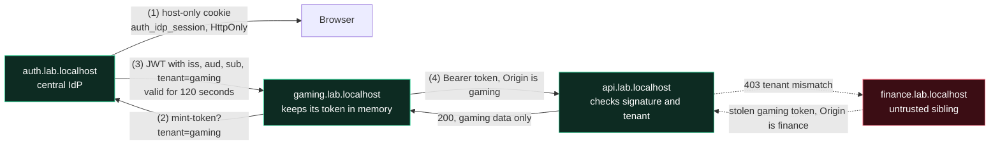

# Backend Security Challenges


> **Learn web security from first principles by breaking and fixing real architectures.**

Reading about a security bug rarely sticks. Watching your own browser leak a session cookie does.

Each lab in this repo is a small, real system that runs on your own machine. First you break it and see the attack work. Then you switch to the fixed design and watch the same attack fail. Every lab comes with a dashboard that shows the traffic as it happens, so you see the cause and not just the result.

Everything here is local and defensive. The servers listen on `127.0.0.1` only. There are no real users, no real secrets, and nothing to deploy.

## Start with Lab 01

You need [Node.js](https://nodejs.org) 18 or newer. Nothing else. No hosts file edits.

```bash
git clone https://github.com/ZeeshanAdilButt/backend-security-challenges.git
cd backend-security-challenges/labs/01-subdomain-token-isolation
npm install && npm start
```

Then open <http://gaming.lab.localhost:3000> and follow the [Lab 01 guide](labs/01-subdomain-token-isolation/README.md).

## Lab 01 in two pictures

### The Trap

A company runs several apps under one domain and wants "log in once, use everything". The quickest way is one session cookie for the whole domain: `Domain=.example.com`.

The browser's same-origin policy keeps pages on different subdomains apart. That cookie walks straight through the wall. The browser sends it to **every** subdomain, so the weakest app now holds the keys to all of them.



One bug in `finance`, or one forgotten subdomain that someone else takes over, and the attacker reads the user's data from every app.

### The Solution

Keep the session cookie in one place and hand each app only what it needs.

- The identity provider (IdP) on `auth.lab.localhost` sets a **host-only** cookie. No `Domain` attribute, so the browser never sends it to any other subdomain.
- Each app asks the IdP for a short-lived **bearer JWT** that carries a `tenant` claim naming that one app.
- The API checks the signature and checks that the `tenant` claim matches the subdomain the request came from.



Now a stolen token is worth very little. It works for one app, from one subdomain, for two minutes.

## Challenge matrix

| Lab | Topic | You break | You build | Status |
| --- | --- | --- | --- | --- |
| [01](labs/01-subdomain-token-isolation/) | Subdomain token isolation | A session cookie scoped to the apex domain that leaks to every sibling subdomain | A central IdP with a host-only cookie and tenant-scoped bearer JWTs | Completed |
| 02 | OAuth 2.0 PKCE and refresh token rotation | An authorization code that can be intercepted, and a refresh token that lives forever | PKCE, refresh token rotation and reuse detection | Upcoming |
| 03 | CORS misconfigurations and preflight bypass | An API that reflects any `Origin` and trusts requests that skip the preflight | A strict allow list and endpoints that do not rely on the preflight | Upcoming |
| 04 | SSRF and internal metadata protection | A URL fetcher that can be pointed at internal services and cloud metadata | Destination allow lists, DNS pinning and blocked internal ranges | Upcoming |

## How every lab is laid out

```
labs/
  01-subdomain-token-isolation/
    README.md        the guide: first principles, attack walkthrough, fix
    server.js        the whole backend in one readable file
    public/          the interactive dashboard
    check.mjs        an automated check you can run with "npm run check"
```

Each lab is self-contained. It has its own `package.json`, so you install and run one lab at a time.

## Ground rules

- **Local only.** Labs bind to `127.0.0.1`. Do not expose them to a network.
- **For learning and defense.** Use these ideas on systems you own or are allowed to test.
- **No real secrets.** Signing keys are generated at startup and thrown away on exit.

## License

[MIT](LICENSE)
